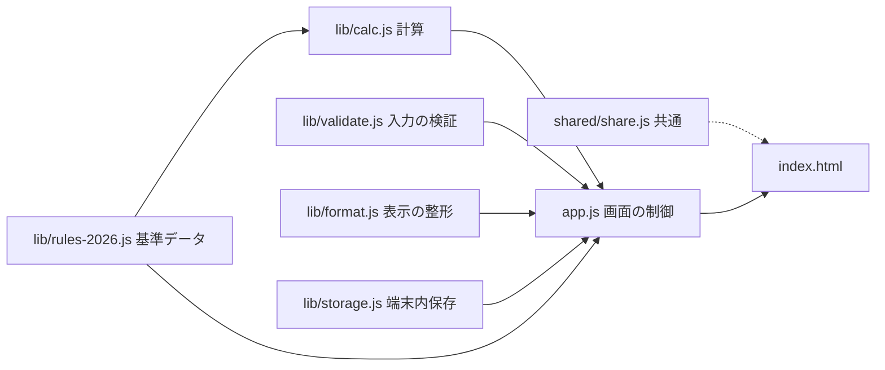
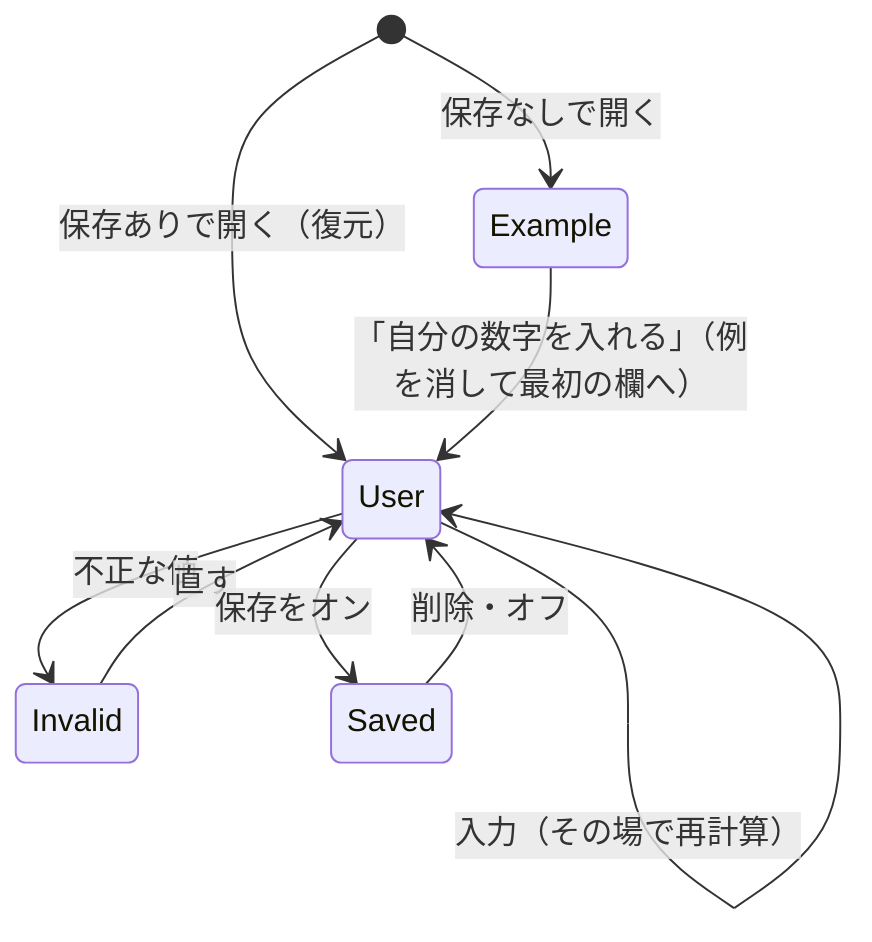

# Design Document

## Overview
**Purpose**：アルバイトをしている学生と保護者に、2026年の年収の壁までの「あと何円・何時間」と、越えると何が変わるかを、一次資料つきで1画面に示す。公開名は「年収の壁時計」。
**Users**：19〜22歳を中心とする学生（16〜17歳・18歳・23歳以上も選べる）と保護者。10〜12月のシフトを決める前に使う。
**Impact**：hundred-days リポジトリに Day069 のフォルダを1つ足し、サイト共通のプライバシーポリシーに1段落を足す。ほかの Day・共通部品・ビルドは変えない。

### Goals
- 税金の壁は、1〜12月に支払われる給与の合計で、残りの金額・時間・給料日1回あたりの上限・越える回を出す
- 健康保険の扶養は、年の合計と混ぜず、月額の目安と1回分の予定額の差として出す
- 数字は1つのデータファイルだけに置き、画面の数字・出典・2025年との比較をそこから組み立てる
- 外部通信ゼロ・入力値の保存は任意・判断や助言の文を出さない

### Non-Goals
- requirements.md の Out of scope すべて（給与以外の収入、配偶者、16歳未満・60歳以上、精密な税額、親の税額の計算など）
- 宣伝動画・X投稿文・デモ動画（本人の別の指示で行う）
- commit・push・PR・公開（status を published にすること）

## Boundary Commitments

### This Spec Owns
- `day-069-nenshu-kabe/` の画面・計算・データ・単体テスト・README・meta.json・公開前確認の記録
- 2026年の基準データ（lib/rules-2026.js）とその照合（research.md）
- `tests/e2e/day-069.spec.mjs`
- `static/privacy.html` の Day069 の段落

### Out of Boundary
- 共通の共有部品（shared/share.js・share.css）の変更。X の `/intent/post` もそのまま使う
- scripts/build.mjs（CSP・OGPの差し込み）の変更。このアプリは既定のCSP（外部接続なし）で動かす
- ほかの Day、トップページ、Obsidian の記録、宣伝用の素材

### Allowed Dependencies
- ブラウザ標準の機能だけ（ES Modules・DOM・localStorage・Intl.NumberFormat・matchMedia）。外部ライブラリ・外部フォント・外部画像は使わない
- サイト共通の shared/share.js・share.css（`npm run shared:sync` で複製）、ビルドによる OGP と canonical の差し込み
- テストは Node 標準の `node:test` と、リポジトリの Playwright（@playwright/test 1.62.1）

### Revalidation Triggers
- 税制・健康保険の基準が変わったとき（2027年分への更新は別の仕様）
- shared/share.js の置き場所の決まりや、build.mjs の CSP が変わったとき
- privacy.html の構成が変わったとき

## Architecture

### Architecture Pattern & Boundary Map
静的な1ページ。純粋関数の計算層と、画面の制御を分ける。既存の Day（062・065）と同じ「app.js が lib/ を読み、tests/ が lib/ を直接試す」形。



**依存の向き**：rules-2026 → calc → app。validate・format・storage は何も import しない。app.js 以外は DOM に触れない（storage だけは渡された Storage を使う）。逆向きの import は誤りとして扱う。

### Technology Stack
| Layer | Choice | Role | Notes |
|---|---|---|---|
| 画面 | HTML・CSS・素の JavaScript（ES Modules） | 入力・結果・説明 | 既存の Day と同じ。ビルド手順なし |
| 計算 | 純粋関数（lib/） | 壁の判定・残り・時間 | 円は整数で扱う |
| 保存 | localStorage（任意） | 入力値の復元 | キー `day069-nenshu-kabe:v1` |
| 配信 | Cloudflare Pages（既存） | 静的配信 | CSP は既定（connect-src 'self'） |
| テスト | node:test・Playwright | 単体・画面 | CI の既存の流れに乗る |

## File Structure Plan

```
day-069-nenshu-kabe/
├── index.html           # 画面の骨組み。見出し・入力欄・結果の器・注意書き・出典・#share
├── app.css              # 見た目。色のトークン、2段組み、状態の色と記号、動きを減らす設定
├── app.js               # 画面の制御。入力→検証→計算→描画、例の表示、保存、読み上げ
├── favicon.svg          # 壁時計のアイコン（自作のSVG）
├── lib/
│   ├── rules-2026.js    # 基準・2025年の値・越えると変わること・窓口・出典・計算式の説明
│   ├── calc.js          # 給与所得、年齢区分ごとの壁の一覧、評価、健康保険の月額比較
│   ├── validate.js      # 入力の解釈（全角数字・カンマ）と上限の検証
│   ├── format.js        # 円・万円・時間の表示
│   └── storage.js       # 任意保存の読み書き・削除と失敗の扱い
├── tests/               # package.json・index.mjs と、calc・rules・validate・storage の単体テスト
├── meta.json            # Day情報（status は draft）
├── README.md            # 何をするか・前提・出典・限界
└── PUBLICATION_CHECK.md # 公開前の法務・権利・プライバシーの確認記録（詳細は research.md）
```

### Modified / Added outside the Day folder
- `tests/e2e/day-069.spec.mjs`（新規）— 画面テスト
- `static/privacy.html` — Day069 の保存・通信の段落を追記
- `README.md`（ルート）— `npm run index:sync` で一覧に1行（生成）
- `day-069-nenshu-kabe/shared/` — `npm run shared:sync` の複製（生成）
- `.agent-harness/contracts/day069-nenshu-kabe.md` — 評価ループの契約（この仕様へのリンク・合格基準・停止条件だけ）
- `.agent-harness/runs/day069-nenshu-kabe/` — 撮影・採点・レビューの記録

## Data Models

### 入力（Inputs）
```js
/** @typedef {'u18'|'a18'|'a19_22'|'a23p'} AgeBand  // 2026-12-31時点：16〜17歳／18歳／19〜22歳／23歳以上 */
/** @typedef {{ ageBand: AgeBand, student: boolean, paidSoFar: number, hourlyWage: number|null,
 *              remainingPaydays: number, hoursPerPayday: number|null }} Inputs */
```
- 金額は円の整数。`hourlyWage`・`hoursPerPayday` が空なら null（時間と予定は出さない）
- 上限：paidSoFar 0〜10,000,000、hourlyWage 1〜10,000、remainingPaydays 0〜12 の整数、hoursPerPayday 0〜400

### 基準データ（lib/rules-2026.js）
```js
/** @typedef {{ id: string, title: string, who: 'self'|'parent', kind: 'cliff'|'step'|'switch'|'info',
 *              boundary: 'lte', threshold: number, rangeLow?: number, appliesTo: (p: {ageBand: AgeBand, student: boolean}) => boolean,
 *              prev2025: number|null, effect: string, window: string, formula: string, sources: string[] }} TaxWall */
/** @typedef {{ annualLimit: number, boundary: 'lt', monthlyLabel: string, monthlyMax: number }} HealthRule */
```
- 税金の壁はすべて給与収入の「以下」（research.md の表）。健康保険だけ「未満」
- 給与所得：給与収入 R が 741,000円未満なら0、741,000円以上2,191,000円未満なら R−740,000（このアプリの範囲はここで足りる）。所得の基準は「所得＋74万円」で給与収入に直し、テストで research.md の表と照合する
- 親の控除の段階表（所得税・住民税）と、16〜17歳・18歳・23歳以上の崖（136万円以下で38万円・33万円、超えると0）も持つ
- `sources` は出典ID。出典は `{ title, publisher, url }` の表で一元管理し、PDL1.0 の規約ページも持つ

| id | 対象（年齢・学生） | 基準（給与収入） | kind |
|---|---|---|---|
| resident-flat | u18以外 | 1,190,000（範囲の下端 1,120,000） | cliff |
| resident-minor | u18 | 2,090,000 | cliff |
| resident-income-student | u18以外の学生 | 1,430,000 | cliff |
| parent-dependent | 全員 | 1,360,000 | a19_22 は switch、ほかは cliff |
| parent-income-tax-full | a19_22 | 1,590,000 | step |
| work-student-limit | u18以外の学生 | 1,630,000 | cliff |
| parent-resident-full | a19_22 | 1,690,000 | step |
| self-income-tax | 全員 | 1,780,000 | cliff |
| parent-zero | a19_22 | 1,970,000 | cliff |

健康保険：a19_22 は 1,500,000 未満（月額「12万5千円未満」、monthlyMax 124,999）、ほかは 1,300,000 未満（月額「108,333円以下」）。

### 結果（calc.evaluate の戻り値）
```js
/** @typedef {'clear'|'will-cross'|'crossed'} WallStatus */
/** @typedef {{ wall: TaxWall, status: WallStatus, remaining: number|null, remainingHours: number|null,
 *              perPaydayCap: number|null, perPaydayHours: number|null, crossAtPayday: number|null, overBy: number|null,
 *              low?: Omit<WallResult,'wall'|'low'> }} WallResult  // low は resident-flat の範囲の下端 */
/** @typedef {{ walls: WallResult[], nearest: WallResult|null, projected: number, perPaydayPlanned: number|null,
 *              health: { rule: HealthRule, diff: number|null } }} Evaluation */
```
- remaining ＝ 基準 − 支払い済み（越えていれば null、overBy に越えた額）。時間は時給で割って切り捨て
- perPaydayCap ＝ floor(remaining ÷ remainingPaydays)。回数0なら null
- projected ＝ 支払い済み ＋ 回数 × 時給 × 時間。予定どおりで越えるなら status は will-cross、crossAtPayday は越える最初の回、overBy は越える見込みの額
- nearest は越えていない壁のうち残りが最小のもの（switch は除く。範囲は下端で比べる）
- health.diff ＝ monthlyMax − 1回分の予定額（予定が無ければ null）。給料日1回を1か月分とみなして比べ、その前提を画面に書く（週払いなどは対象外と示す）

### 保存（storage.js）
- キー `day069-nenshu-kabe:v1`、値は Inputs と `savedAt`。保存がオンで、例ではないときだけ書く。オフにしたら消す
- 読み込みで形が違えば捨てる。例外は全部捕まえて `{ ok: false, reason }` を返す

## Components and Interfaces

| Component | Intent | Req | Contracts |
|---|---|---|---|
| rules-2026 | 基準・説明・出典の唯一の置き場 | 2, 3, 4, 6 | State（定数） |
| calc | 壁の一覧と評価（純粋関数） | 2, 3 | Service |
| validate | 入力の解釈と検証 | 1.5 | Service |
| format | 表示の整形 | 2, 3 | Service |
| storage | 任意保存 | 7.3–7.5 | Service |
| app | 画面の制御と描画 | 1–10 | State |

```js
// calc.js
export function salaryIncome(R) {}            // → 給与所得（円）
export function wallsFor(profile) {}          // → TaxWall[]（基準の小さい順）
export function evaluate(inputs) {}           // → Evaluation（inputs は検証済み）
export function parentDeduction(R, ageBand) {} // → { incomeTax, residentTax }（円）
export function healthRule(ageBand) {}        // → HealthRule
// validate.js
export function parseYen(text) {}             // → { ok: true, value } | { ok: false, message }
export function validateInputs(raw) {}        // → { ok: true, inputs } | { ok: false, errors: { [field]: message } }
// storage.js
export function load(storage) {}  export function save(storage, inputs) {}  export function clear(storage) {}
// format.js
export function yen(n) {}  export function man(n) {}  export function hours(n) {}
```

**app の状態**：`mode`（example／user）、`inputs`、`saveEnabled`、`errors`。入力のたびに validate → evaluate → render（同期・1フレーム内）。読み上げは `aria-live="polite"` の1か所に「いちばん近い壁まであと◯円」だけを書く。

## System Flows



例の値（架空）：19〜22歳・学生・支払い済み1,030,000円・時給1,200円・残り3回・1回85時間。住民税の均等割を予定どおりだと越える、が見える組み合わせにする。

## UX5階層（構造・骨格・表層）
- **構造**：1ページ。上から、見出しと「2026年の制度・確認日」→（例のとき）例のお知らせ→入力→いちばん近い壁（壁時計）→壁の一覧→健康保険の扶養→参考→2025年からの変化→このアプリについて（概算・税理士でない・相談不可・非公式・出典）→共有。迷う分岐は「例か自分の数字か」だけで、復帰路は「例に戻す」ボタン
- **骨格**：スマホは1列、幅1024px以上は左に入力（追従）・右に結果の2段組み。いちばん大きい要素は壁時計の「あと◯時間（◯円）」の1つだけ。壁の一覧は縦の線でつないだ時系列の形にし、「いまここ（支払い済み）」と「予定どおりなら」の印を、該当する金額の位置の壁と壁のあいだに差し込む（これを1本の目盛りとする。比率の目盛りは数字が重なるため採らない）。各壁は折りたたみで計算式と出典を開ける
- **表層**：クリーム地・濃紺の文字・れんが色を壁のしるしに使う。状態は色だけにしない（まだ＝○青、予定だと越える＝△こはく色、越えた＝×紫がかった灰）。赤と緑に意味を持たせない。文字はシステムの書体、数字は等幅（tabular-nums）。壁時計はSVGの文字盤で、支払い済み÷いちばん近い壁の割合を弧で示す。数字の切り替えと弧の動きは、動きを減らす設定で止める。官公庁の配色・ロゴ・紋章は使わない

## Requirements Traceability

| Req | Design element |
|---|---|
| 1.1, 1.2, 1.3, 1.6 | index.html の入力欄と説明、app の描画 |
| 1.4 | app：input イベントで同期再計算 |
| 1.5 | validate.validateInputs、app の欄ごとのエラー表示 |
| 2.1, 2.2, 2.3, 2.4, 2.5 | calc.evaluate（remaining・時間・perPaydayCap・crossAtPayday・overBy） |
| 2.6 | 壁の一覧の時系列と「いまここ／予定どおりなら」の印 |
| 2.7 | resident-flat の範囲（low と本体の2つの結果） |
| 2.8 | parentDeduction と段階表、parent-* の壁 |
| 2.9 | resident-income-student・work-student-limit と申告の注記 |
| 3.1, 3.2, 3.3, 3.4, 3.5 | healthRule・health.diff、健康保険の説明（rules-2026 の文言） |
| 4.1, 4.2, 4.3, 4.5, 4.6 | rules-2026 の effect・window・formula・用語の説明、参考の節 |
| 4.4 | prev2025 と「2025年からの変化」の表 |
| 5.1, 5.2, 5.3, 5.4, 5.5, 5.6, 5.7, 5.8 | このアプリについての節、結果のそばの常時表示、文言の検査（禁止語のテスト） |
| 6.1, 6.5, 6.6 | sources と出典表、PDL1.0 の表示、各壁の折りたたみ |
| 6.2, 6.3 | 見出しの年の表示、2027年以降の帯（今日の日付で判定） |
| 6.4 | research.md の ✕ の数字を rules に入れない（rules のテストで固定） |
| 6.7 | 時間の表示のそばの注記 |
| 7.1, 7.2, 7.3, 7.4, 7.5 | storage、外部通信なし、共有文の固定 |
| 7.6 | static/privacy.html の追記 |
| 8.1, 8.2, 8.3 | app の mode と例の値 |
| 9.1, 9.2 | shared/share.js と `meta name="share:text"`（固定文） |
| 10.1, 10.2, 10.3, 10.4, 10.5, 10.6, 10.7 | app.css のレイアウト・44px・状態の記号、aria-live、prefers-reduced-motion |

## Error Handling
- 入力の誤り：欄のそばに理由を出し、`aria-invalid` を付け、結果は「入力を直すと表示します」に置き換える
- 保存の失敗：保存欄に「この端末に保存できませんでした」を出し、計算は続ける
- 2027年以降：結果より上に「2027年分には対応していません」の帯を出す（計算は2026年として表示）
- 時給が空：時間を出さず金額だけ。残りの回数が0：1回あたりの上限を出さない
- すべての壁を越えた：壁時計に「表示している壁はすべて越えています」と出す

## Testing Strategy
- **単体（node:test）**
  - salaryIncome の境界（740,999→0、741,000→1,000、1,360,000→620,000）
  - rules の基準が research.md の表と一致する（119・112・143・136・159・163・169・178・197・209万円）。出典IDがすべて存在し、2025年の値は照合済みのものだけ
  - evaluate：基準ちょうどと1円多い額で越える・越えないが入れ替わる。already crossed、will-cross と越える回、1回あたりの上限と時間の切り捨て、時給なし・回数0
  - wallsFor：年齢区分と学生の組み合わせごとに壁の一覧が決まる（u18 は 209万円、学生でなければ 143・163万円なし、a19_22 だけ 159・169・197万円）
  - parentDeduction の段階の境界（159万円→63万円、159万円＋1円→61万円、197万円→3万円、197万円＋1円→0）と崖（136万円＋1円→0）
  - 健康保険の月額（130万円→108,333、150万円→124,999）と差の符号
  - validate：全角数字・カンマは通し、文字・負の数・上限超えは理由つきで落とす
  - storage：保存・復元・削除、形が違うデータの破棄、例外を投げる Storage での失敗の返し方
  - 画面の文言に、勧める・請け負う表現（「すべき」「お得」「大丈夫です」「一切の責任」など）を含まない（rules と index.html を検査。「保証するものではありません」のような限界の説明は対象外）
- **画面（Playwright、tests/e2e/day-069.spec.mjs）**
  - 開くと例の結果と「例」の表示が出る。コンソールのエラー・CSP違反・外部への通信が0件
  - 「自分の数字を入れる」で例が消えて最初の欄に移り、入力でその場で結果が変わる。基準ちょうどと1円多い額の表示
  - 年齢区分を変えると壁の一覧と健康保険の基準が変わる
  - 不正な値で欄にエラーが出て、結果が置き換わる
  - 保存は最初オフ。オンで再読み込み後に復元、削除で例に戻る。保存が投げる環境でも計算が続く
  - 共有のXとLINEのリンクに、入力した金額が含まれない
  - 320・390・844×390・1440の幅で横にはみ出さない。押せる部品が44px以上。キーボードだけで最後まで操作できる
  - 時計を2027-01-01にすると帯が出る。動きを減らす設定で動きが止まる
- **評価ループ**：テストが全部通ってから、390と1440の幅で撮影し、画面だけを見る別の評価者（Opus・別セッション）が10項目で採点する。16点以上かつ0点なしで合格。最大3周、同じ指摘が2周続いたら本人へ返す。読み取り専用の独立したコードレビューも行う

## Security & Privacy
- 外部通信なし。入力値は URL・共有文・保存（オフ時）に入れない。アクセス解析はこのページに入れない（既存方針どおり）
- インラインスクリプトを書かない（script-src 'self'）。ユーザーの入力を innerHTML に入れない（textContent で描画）
