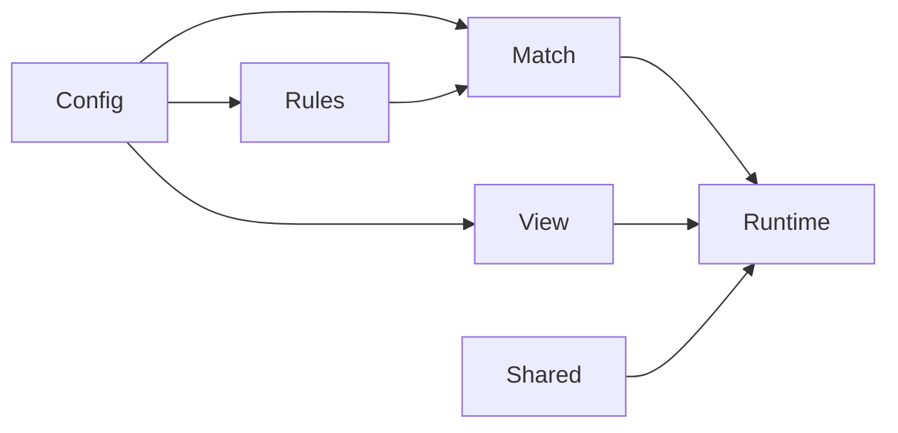
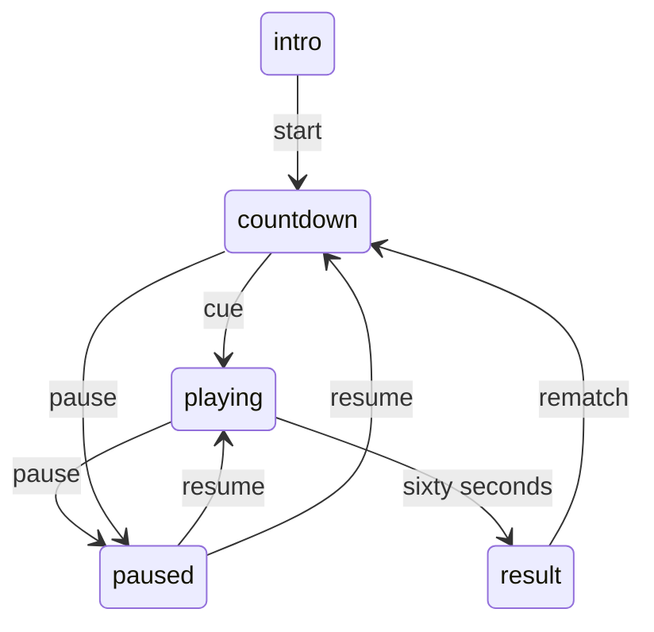

# 技術設計：フリップコート

## Overview
1人がCPUと60秒打ち合い、着地と8方向の反転で陣地を争う静的Webゲームを作る。
Goalsは開始・返球・反転・終了・再戦の完結、Non-Goalsはオンライン対戦・会員・ランキング・既存Dayの改修。

## Boundary Commitments
### This Spec Owns
新Dayの盤面、ラリー・CPU・時計、入力、描画、結果、ローカルpreview、検査。
### Out of Boundary
既存Dayの遊び、共通共有機能の挙動、公開・SNS操作、他worktreeの変更。
### Allowed Dependencies
ブラウザ標準API、Node標準API、既存shared正本、既存Playwright 1.62.1のみ。
### Revalidation Triggers
世界座標・モデル・描画契約、60秒境界、共有コピー、配信許可リストが変われば依存側を再検査する。

## Architecture

ModelをDOMから独立させ、Runtimeだけが入力・時計・画面を接続する。Viewは判定を持たない。
FrontendはES Modules・Canvas 2D・DOM、RuntimeはNode 24、検査はNode testと既存Playwright。新規依存なし。

## File Structure Plan
| コンポーネント | 作成するファイル（新Day配下） | 責務 |
|---|---|---|
| WorldConfig | lib/config.js、package.json | 世界座標・共有定数・ES Modules |
| Rules | lib/rules.js、tests/rules.test.mjs | 初期盤面・8方向の反転・陣地集計 |
| Match | lib/match.js、tests/match.test.mjs | ラリー・CPU・時間・中断・結果 |
| View | index.html、app.css、lib/view.js | UIの骨格、Canvas描画、画面幅と色・印 |
| Runtime | app.js | Pointer/Key入力、単一RAF、DOM状態とdialog |
| Repository | meta.json、README.md、shared/、og.png、tools/serve.mjs、tools/capture-og.mjs | 制作記録・既存共有・自作画像・draft preview |
| Validation | tests/index.js、ルートtests/e2e/day-070.spec.mjs | 単体入口・実ブラウザの主要フロー |
既存の変更はscripts/build.mjsのtools除外と、READMEの一覧同期だけに限る。

## Components and Interfaces
- WorldConfig: WORLDを凍結して公開。幅600・高さ760、盤面x42/y122/一辺516、6行、ラケットy56/704・幅112。
- Rules: createBoard(): number[36]、getScores(board): {player,cpu}、applyLanding(board,index,owner): {board,flipped,changed}。ownerは1/2、空きは0。
- Match: createMatch(seed=1)、beginMatch(match)、stepMatch(match,deltaMs,axis=0)、movePlayerTo(match,x)、pauseMatch(match)、resumeMatch(match)を公開する。
- View: createRenderer(canvas)は{resize(),render(match,{reducedMotion})}を返す。context取得不可はnullを返す。モデルは変更しない。
- Runtime: currentMatchを唯一の進行元とし、モデルとViewを接続する。開始/再戦では新しいモデルを作り、古い入力を破棄する。
- Repository: draftを標準配信から除外したまま、公開ファイルだけを配るsource previewを使う。テストはworker専用portで起動する。

## Data Models
Matchはphase、resumePhase、board、scores、elapsedMs、countdownMs、serveMs、playerX、cpuX、ball、lastLanding、lastEvent、result、乱数状態を持つ。
phaseはintro/countdown/playing/paused/result。ballの描画値はx/y/zと着地予告targetX/targetY、lastLandingはid/atMs/owner/cell/flipped/changed。
resultはwinner（0=同点、1=自分、2=CPU）とplayer/cpuの確定陣地数。詳細契約は[model.md](model.md)。
外部保存や通信は持たず、永続的な個人データを扱わない。

## System Flows

返球ミスはplaying内で次のサーブへ移る。背景化、共有・説明を開く操作はpauseへ接続する。

## Requirements Traceability
| 要件 | コンポーネント | 契約・確認する流れ |
|---|---|---|
| 1.1, 1.2, 1.3, 1.4 | View, Match, Runtime | 説明→合図→1人CPU戦 |
| 2.1, 2.2, 2.3 | Runtime, Match | 座標変換・キー・入力解放 |
| 2.4, 2.5 | Match | 当て方で打ち分け、CPUも同じ判定 |
| 3.1, 3.2, 3.3, 3.4, 3.5, 3.6 | Rules, Match | 1打1着地、8方向、境界、重複拒否、集計 |
| 4.1, 4.2, 4.3, 4.4, 4.5, 4.6 | Match, Runtime | 時限・ミス・pause・再開・新規試合 |
| 5.1, 5.2, 5.3, 5.4, 5.5, 5.6 | View, Runtime | HUD・反転・結果・幅・focus・印 |
| 6.1, 6.2, 6.3, 6.4, 6.5 | Repository, Runtime, View | 既存共有・dialog・正規URL・自作OG |
| 6.6 | View, Runtime | 描画不可時の案内と開始禁止 |

## Testing Strategy
Rulesは8方向・空き/端・複数方向・非連鎖・入力不正・元盤面不変を検証する。
Matchは左右の打ち分け、CPUの移動上限、1打1着地、ミス再開、60秒直前/同時/直後、同点、pause/再戦を検証する。
実ブラウザはChromium/WebKitで開始・キー/タッチ・終了・再戦・pause・共有・描画不可・幅360/390/768/1440を確認する。
時計境界の制御と別に、5〜10分の実時間プレイと画像の独立評価を行う。UI判断は[ux.md](ux.md)を使う。
標準check/buildはdraftを公開しないことも確認する。必要な検査が通れば、理由なく全件を繰り返さない。

## Error Handling and Security
入力値とdeltaの有限性、ownerとマス範囲を入口で確認する。HTTP previewは許可した静的ファイルだけを配る。
CSPはselfを基本にし、eval・外部フォント・外部素材・データ送信を追加しない。描画できなければ再開可能な案内を出す。
