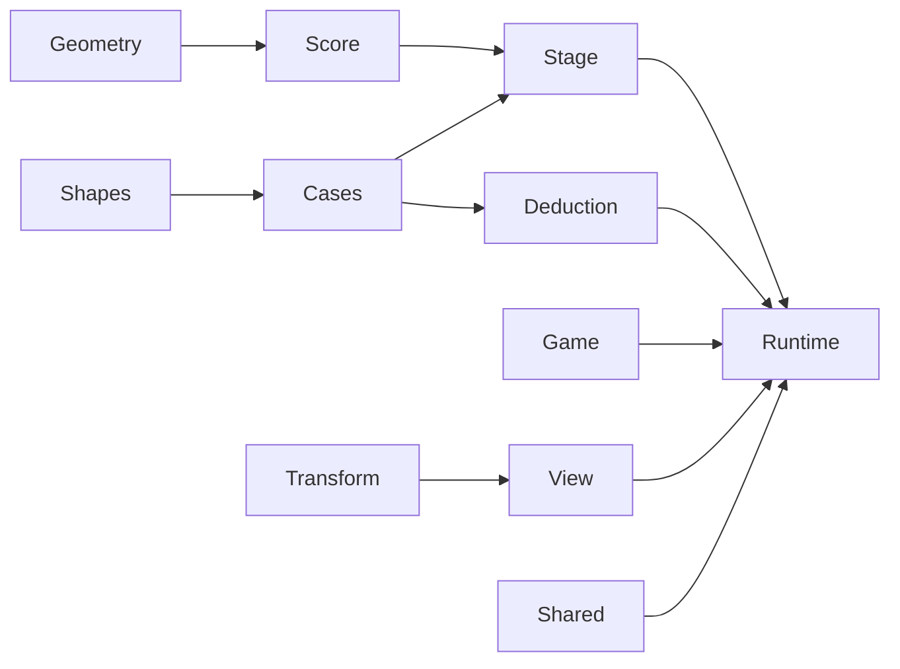
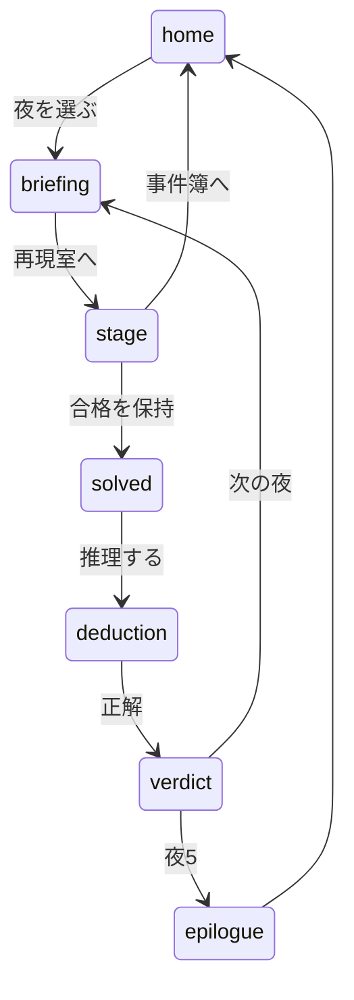

# 技術設計：影証言

## Overview
灯りの高さと道具の横位置を動かして、壁の影を証言のスケッチに重ねる静的Webゲームを作る。
Goalsは、再現・推理・星・保存・共有の完結。Non-Goalsは、オンライン機能・ランキング・音・3D・既存Dayの改修。

## Boundary Commitments
### This Spec Owns
新Dayの幾何・採点・事件簿・推理・セッション・進行・描画・画面・入力・結果・ローカルpreview・検査。
### Out of Boundary
既存Dayの遊び、共通共有機能の挙動、他のworktreeの変更、SNS操作、公開（published・マージ・デプロイ）。
### Allowed Dependencies
ブラウザ標準API、Node標準API、既存の `shared/` 正本、既存のPlaywright 1.62.1のみ。
### Revalidation Triggers
影の投影式・格子・判定のしきい値・場面の数値が変われば、`tests/cases.test.mjs` と体験評価をやり直す。DOM契約・共有コピー・配信許可リストが変われば、E2Eと標準ビルドをやり直す。

## Architecture

Geometry・Score・Cases・Deductionは画面にも時計にも依存しない。StageとGameは、その上に操作と進行の状態を持つ純粋なモデル。ViewはモデルをCanvasへ描くだけで、判定を持たない。Runtimeだけが、入力・タイマー・DOM・保存・共有を接続する。
実装は ES Modules、Canvas 2D、DOM。Node 24のテストと既存Playwrightで検査する。新規依存はなし。

## File Structure Plan
`day-071-kage-shogen/` の下：

| コンポーネント | ファイル | 責務 | 状態 |
|---|---|---|---|
| Geometry | lib/geometry.js・lib/shapes.js・tests/geometry.test.mjs | 投影・塗りつぶし・IoU・道具の形 | 参照実装済み。テストを足す |
| Score | lib/score.js・tests/score.test.mjs | 部品ごとの被覆と邪魔な道具を含む合否 | 参照実装済み。テストを足す |
| Cases・Deduction | lib/cases.js・lib/deduction.js・lib/config.js・tests/cases.test.mjs・tests/deduction.test.mjs | 物語・場面の数値・推理 | 実装済み。cases.testは済。deduction.testを足す |
| Stage | lib/stage.js・tests/stage.test.mjs | 1夜の操作の状態 | 実装済み |
| Game | lib/game.js・tests/game.test.mjs | 星・解放・保存 | 実装済み |
| Transform・Hit・View | lib/transform.js・lib/hit.js・lib/view.js・tests/{transform,hit,view}.test.mjs | 座標変換・つかむ対象の判定・Canvas描画（壁・スケッチ・現場図） | 実装済み（設計側） |
| UI | index.html・app.css | 画面の骨格・トークン・DOM契約 | 実装する |
| Runtime | app.js | 入力・phase・タイマー・保存・dialog・共有の接続 | 実装する |
| Repository | meta.json・README.md・shared/・og.png・tools/serve.mjs・tools/capture-og.mjs | 制作記録・共有・自作の紹介画像・preview | 実装する |
| Validation | tests/index.js・ルートtests/e2e/day-071.spec.mjs | 単体の入口・実ブラウザの主要フロー | 実装する |

既存の変更は、`scripts/build.mjs` のtools除外1項目と、READMEのDay一覧（`npm run index:sync`）だけに限る。

## Components and Interfaces
- **View**：`createWallRenderer(canvas)`・`createSketchRenderer(canvas)`・`createSideRenderer(canvas)` は、それぞれ `{ resize(), render(...) }` を返す。2D contextを取れなければ `null`。モデルを変更しない。Canvasの実解像度は表示サイズ×devicePixelRatio。ポインター座標は `createTransform` で世界座標へ戻す。
  - wall の `render({ stage, arrangement, selected, guideOn, flash })`。描画順は ux.md の「壁と操作」。ねらい（ガイド）は `stage` の正解から描く。`flash`（0〜1）は成功の輪郭の光らせ方で、動かすのはRuntime。
  - sketch の `render(stage)`：ねらいを小さな黒い影絵として描く。
  - side の `render({ stage, caseDef, arrangement })`：現場図。
  - hit の `hitTest(transform, stage, arrangement, px, py)`：'lamp'・すべれる道具のid・null。ポインターが何をつかむかの判定（`lib/hit.js`）。
  - 描画器は、非表示（大きさ0）のcanvasには描かない。
- **Runtime**：現在のphase・セッション・進行を1か所に持つ。描画は、状態が変わったときだけ `requestAnimationFrame` で1回にまとめる。そろえる動き・長押しの繰り返し・合格の保持は、それぞれ1つのタイマーで管理し、画面の遷移・はじめから・合格の取り消しで必ず止める。古いタイマーの結果を、新しい状態へ適用しない。
- **Repository**：制作中は `status: "draft"` で標準配信から除外する。source previewは公開ファイルだけを配り、テストはworker専用portで起動する。

## Data Models
[model.md](model.md) のとおり。永続化するのは進行（解決した夜と星）だけで、個人データは扱わない。

## System Flows

誤答は deduction の中で扱う。合格を保持するあいだに操作が再開されたら、保持を取り消して stage に残る。

## Requirements Traceability
| 要件 | コンポーネント | 契約・確認する流れ |
|---|---|---|
| 1.1〜1.5 | Game, Runtime, UI | 事件簿・鍵・星・概要・ログイン不要 |
| 2.1〜2.8 | Stage, View, Runtime | 縦レールと棚・相似拡大・3通りの入力・離したら止める・はじめから・ガイド |
| 3.1〜3.7 | Score, Stage, Runtime, View | 3条件・近さ4段階・そろえて現場図・12cm以上は不成立・3cmは成功・邪魔な道具 |
| 4.1〜4.6 | Deduction, Runtime | 手がかりと容疑者・2人→1人・正誤の理由・踏み台・✕は判定外 |
| 5.1〜5.6 | Game, Runtime | 星・最高星・保存と復元・保存不可・エピローグ・リセット |
| 6.1〜6.5 | UI, View, Runtime | 幅・44px・焦点・読み上げ・reduced-motion・単独操作 |
| 7.1〜7.5 | Repository, Runtime, View | 共有・OGP・描画不可・外部通信なし |

## Testing Strategy
- **単体**（`node --test`）：Geometryは既知の投影・格子の面積・IoUの対称性と境界。Scoreは部品ごとの被覆・邪魔な道具・しきい値の境界。Casesは済み。Deductionは候補の絞り込みと文。Stageは範囲・選択・微調整・はじめから・成功の確定。Gameは星・解放・壊れた保存。Transformは往復。Viewは偽の2D contextで、呼び出しと `null` の扱い。
- **実ブラウザ**（Chromium/WebKit）：キー・ポインターで夜1を解き、推理・次の夜・保存の復元・共有・描画不可・保存不可・幅360/390/768/1440・外部通信0・CSP違反0。
- **体験と画面の評価**：5〜10分の実操作と、画像の独立評価（[ux.md](ux.md)の確認する画面）。時計の境界は無いので、`page.clock` は使わない。
- **標準check**：`npm run check`、`npm run build`（draftの除外と、公開時の配信・tools除外）。

## Error Handling and Security
入力の数値は有限性と範囲を入口で確認し、未知のidは無視する。保存は読み書きとも例外を握りつぶさず、失敗を `false` で返して画面に簡潔に案内する。文は `textContent` で入れ、`innerHTML` にデータを渡さない。
CSPは `self` を基本にし、`eval`・インラインスクリプト・外部フォント・外部素材・データ送信を追加しない。描画できなければ、開始を無効にして案内を出す。
