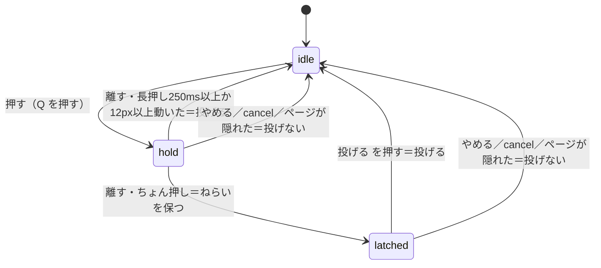

# Design Document

## Overview
**Purpose**: 影討ちをスマホの親指で遊べるようにする。タッチは「もう一つの入力源」として既存の入力窓口（`InputState`）に流し込み、規則（`src/sim/`）・ステージ・見た目の方針には触れない。
**Users**: Xのリンクからスマホで来る人（横向き）。デスクトップの人には何も変わらない。
**Impact**: 設計書の「入れない：スマホ操作」を外す。タッチ部品・スマホ向けHUD・横向き案内・自動の画質調整を足す。これらはタッチモードのときだけ働き、オフなら今と同じ。

### Goals / Non-Goals
- Goals: 全画面をタッチだけで進める／そっと歩ける／走るは意図したときだけ／見つかっても動ける／重い機種でも止まらない
- Non-Goals: 設定画面・保存・縦向き・ピンチ・全画面・振動・ゲームパッド・左利きの入れ替え（実機で要ると分かったら別仕様）

## Boundary Commitments
### This Spec Owns
- ポインタ→`InputState` の経路と、タッチ部品の見た目・配置／スマホ向けの文言とHUDの収まり／ページ単位の扱い（拡大・スクロール・音・復帰・横向き）／描画の段階（画素比とAO）
### Out of Boundary
- `src/sim/**`（規則・速さ・音の大きさ）、`src/stage/**`、`src/art/world/**`・`characters/**`、カメラの数値（視点の倍率だけ新設）、音の合成、`shared/` の共有欄
### Allowed Dependencies
- `InputState` の注入口、`GameStateOut`（読むだけ）、`Game` の画面 API、Pointer Events・`matchMedia`・`visibilitychange`・WebGL のコンテキスト喪失イベント。新しいnpm依存は足さない
### Revalidation Triggers
- `SimInput` の形、`KEYS` の割り当て、`player.prompt`／`mission.interaction` の意味、`hooks.d.ts`、CSP の変更

## Architecture
### Existing Architecture Analysis
- 入力は `InputState` 1か所。`main.ts` の `makeInput()` が `SimInput` を作る。sim は `moveX/moveY` の長さ（最大1）をそのまま速さの割合にするので、アナログのスティックが使える
- 視点は `rig.look(dx,dy,aiming)`（マウス移動量）。狙い中の上下は投げる距離になる。ポインタロックはタッチで使えない（失敗しても黙って続く）
- 画面は `Game.screen` で切り替わり、`#ui` は `pointer-events:none`（ボタンと説明のスクロール枠だけ有効）。描画は `ArtView`（画素比の上限1.5・N8AO・ブルーム・SMAA）
### Architecture Integration
- 方式: 純粋関数（`touchMath`）＋DOM層（`TouchControls`）＋配線（`main.ts`）。スティックは専用の注入口（`injectStick(x,y,run)`）、ボタンはタッチ専用の保持集合（`touchKeyDown/Up(code)`）に載せる。`held()` は物理とタッチの和で、タッチが物理キーの押下を解放しない。遊びを止める経路（一時停止ボタン・向きガード・可視性・blur）は共通の `interruptPlay()`（狙い中なら中止要求→タッチと物理の押下を解放→必要なら `game.pause()`）を通す。Esc の経路は変えない＝規則側の変更ゼロ
- タッチ層は `#game` と `#ui` の間に置く。HUDは `pointer-events:none` なので指は下の層に届く。遊ぶ画面以外では隠す
- モードの正本は `<html>` の `kg-touch` クラス1つ。部品・HUD・ページの基礎CSS（`overscroll`・`touch-action`・選択抑止）・初回ヒント・画質・向きガード・可視性停止が同じ判定を読む。キャンバス寸法の `dvh` は全端末共通（PCでは `vh` と同じ値）
- 新しい部品の理由: 状態機械とスティック計算は、DOMなしで単体試験したいので分ける
- 技術: Pointer Events（触れる層はマウス・ペンも受ける＝評価ツールがマウスで押せる）。CSS は `dvh`・`env(safe-area-inset-*)`・`touch-action`（遊ぶ層は `none`、長い画面は `pan-y`）。段階は画素比とAO。影・ブルームは測って得なら足す（4.2）

## File Structure Plan
```
src/config/touch.ts        # スティック半径・不感帯・走りの輪・視点の倍率・長押し判定（調整はここだけ）
src/input/touchMath.ts     # 純粋：スティックの量と走り（ヒステリシス）、小石ボタンの状態機械
src/input/touch.ts         # DOM：TouchControls、触れる端末の判定
src/ui/touch.css           # タッチ部品とスマホ向けHUD（.kg-touch 配下）
src/art/render/quality.ts  # 段階の表（4段）と QualityGovernor（純粋）
tests/touchMath.test.ts  tests/quality.test.ts  tests/promptText.test.ts
e2e/touch.spec.ts  e2e/touch-helper.ts            # 電話サイズの試験
tools/lib/touchBot.mjs  tools/touch-shots.mjs      # 台本をタッチで流す／端末サイズ別の撮影
```
### Modified Files
- `src/input/input.ts` — `injectStick`・`stick()`・`touchKeyDown/Up`。`releaseAll` でタッチ側も0に
- `src/main.ts` — `makeInput` の合成、タッチ層の生成と毎コマの同期、向きガード、可視性での一時停止、音の起動（touchend・click も）、コンテキスト喪失、画質の配線、`lockHint` を出さない
- `src/ui/ui.ts`・`text.ts`・`style.css` — タッチ文言（`promptText(st,touch)` を純関数に）、操作一覧、一時停止の音と画質、横向き案内、小画面対応
- `src/view/GameView.ts`・`artView.ts`・`art/render/post.ts` — `setQuality?(tier)`。AO は `enabled` で切る
- `src/contract/hooks.d.ts`・`index.html` — `__touch`・`__quality`、`viewport-fit=cover`

## System Flows

- 小石が0になる・画面が遊ぶ以外になったら `idle` に戻す。やめるは `cancelAim` を立ててから Q を離す（規則側は投げない）
- 向きガード: 触れる端末が縦向きで `play` → `game.pause()`＋案内。横に戻ると案内が消え、一時停止の画面から再開する

## Requirements Traceability
| Req | 実現する部品 |
|---|---|
| 1 | `detectTouchMode`・`Ui.setTouchMode`・`?touch=` |
| 2・3 | `touchMath.stick`・`TouchControls`（スティック領域・視点領域）・`InputState.injectStick`・`injectMotion` |
| 4 | `TouchControls` のボタン・`promptText`・`sync(state)` |
| 5 | `AimButton`（touchMath）・`main.ts` の `cancelAimReq` |
| 6・7 | `ui.ts`（一時停止の項目・文言）・向きガード・`visibilitychange` |
| 8 | `touch.css`（`.kg-touch` のHUD配置）・初回ヒント |
| 9 | `index.html`・`style.css`・音の起動・コンテキスト喪失の表示 |
| 10 | `quality.ts`・`ArtView.setQuality`・`main.ts` の配線・一時停止の表示 |
| 11 | tests／e2e／tools |

## Decisions and rejected alternatives
- **走りはスティックの外側の輪（半径の約1.4倍）**。捨てた案は「全力で倒す＝走る」。歩きの最高速を出そうと全力で倒す人が、走って足音を立てて見つかる（キーボードは走りが別キーで起きない）
- **スティックは浮動型＋薄い目印**。固定型は親指の位置が合わないと誤差が出る。目印が無いと初見で場所が分からない
- **小石は「押す間ねらう」と「ちょん押しで保つ」の両対応**。長押しだけだと視点の指が足りず、タップだけだと素早く投げられない
- **視点は右半分のどこでもなぞれる**。専用のつまみは作らない。押す前に探す手間が増える
- **縦向きは遊ばせず案内**。縦は画角が約24°になり、視界の扇が見えない。HUDの作り直しも重い
- **設定画面・保存は作らない**（設計書の方針）。視点の速さは定数で直す。左利きは未対応と明記
- **画質は自動で下げるだけ**。上げ下げを繰り返すと画面が揺れて酔う。触れる端末は中段（画素比1.25・AOなし）から始める（AOは追加の1パスで重く、小さい画面では差が小さい）。降下は「直近2秒の窓に1.5秒ぶん以上たまり、その90%点が34msを超える」で1段、次まで4秒空ける（コマ数でなく時間で見る＝15fpsでも働く）。250ms超のコマは外れ値だが、窓に4回あれば止まり続けているとして下げる。起動後3秒と、一時停止・復帰・向き変更の直後は数えない。段階を変えたら `setPixelRatio` のあとに必ず `resize()`（合成器が描画バッファを取り直す）
- **攻撃は、間合い（1.65m）の中の最も近い番兵へ自動で向ける（タッチのみ）**。キーボードはマウスでカメラを向けて当てるが、タッチは視点の指と攻撃の指が同じ右手で、向けられず空振りした（体験評価の第1周）。sim は変えず、攻撃の刻みの `camYaw` だけを差し替える。距離の規則は変えない。ピンチ拡大・全画面・振動は見送り（iPhoneで使えず効果が割れる）

## Error Handling
- `pointercancel`・`blur`・`visibilitychange` は、スティック0・ボタン解放・ねらい中止に倒す（押しっぱなしを残さない）
- WebGLのコンテキスト喪失は「画面が止まりました」と読み込み直しのボタンを出す。自動復帰は試みない

## Testing Strategy
- Unit: スティックの不感帯・比例・走りのヒステリシス（1.4で入り1.25で出る）／小石の状態機械（6遷移）／段階の降下（一瞬の遅れで下げない・間隔・上げない・下限）／`promptText` がキーを含まない／物理キーとタッチが同じキーを持つ・離す回帰
- E2E（電話サイズ・Chromium。WebKitでも流せるものは流す）: スティックで歩く・外へ倒して走る・離して止まる／視点ドラッグ／同時操作／4ボタン／小石の3経路／狙い中の一時停止／狙い中に縦向き→横向き→再開で石が減らない／初回タッチでの切り替え／オフのとき見た目と部品が変更前と同じ／縦向き案内／可視性／重なりの監査（568×320〜1024×768）
- 台本 `ura` を、CDP の本物のタッチイベントだけで流して結果画面まで（`tools/lib/touchBot.mjs`。`__touch.info().events` の touch 回数を記録し、mouse が0であることも確かめる）
- 計測: 段階ごとの1コマの時間をこのMacで比べる。実機の値とは言わない

## Security / Performance
- 外部通信・保存・新依存なし。インラインの `style` 属性は使わない（CSP）。DOMは `textContent` で組む。自動の画質調整は、自動操作・撮影・計測では働かない（再現性のため）。最低の段でも重い機種では何もしない（実機の体感は本人が確かめる）
