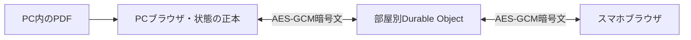

# ブラウザ版の設計

## Overview
利用者はPCでURLを開き、PDFを選択し、スマホからQRで接続する。
ブラウザ表示と暗号化通信に分け、既存app.js/index.htmlの画面・採用/取消・操作を再利用する。

## UX5階層
- 戦略：準備用のインストールを省き、PCから離れて話せる。
- 要件：PDF選択・確認・QR接続・リモコン・切断復帰。
- 構造：PCでURL→PDF確認/採用→スマホでQR→発表→終了。
- 骨格：既存のPC投影・スマホの大きな操作面・QR・カンペ・段階表示を継承する。
- 表層：暗色と赤アクセント、44px操作領域、フォーカスと接続状態の文字表示。

## Goals / Non-Goals
URLのみの利用開始、元PDFのPC内処理、実端末間同期を実装する。PPTX/PPT直接変換・クラウド原本保存・ユーザーログイン・自動SNS投稿は行わない。

## Boundary Commitments
- Relay：Cloudflare Worker/SQLite Durable Objectが部屋の権限・期限・接続・不透明な暗号文の中継だけを担当する。
- Browser：PDF.js描画・全状態・カンペ・画像・AES-GCM鍵を利用者のブラウザ内で保持する。
- UI：既存の読込/採用/取消/発表画面を使い、同じorigin・公開パスのブラウザAPIへ接続する。
## Out of Boundary
既存source/配布ZIPの原本、私的資料、他のDay、個人認証設定、3084サーバーを変更しない。
## Allowed Dependencies
PDF.js6.5.438（Apache2.0、legacy/mainとworker同版）、qrcode-generator2.0.4（MIT）、WebCrypto、Wrangler4.157.0、対応するMiniflare。CDNは使わない。
## Revalidation Triggers
PDF.js/Worker版、通信スキーマ、URL、接続期限、公開route、共有/OGPが変わったら、その境界と統合E2Eを再検証する。

## Architecture

依存方向は UI → Browser API → PDF import / Secure session → Relay。RelayはUIや資料形式に依存しない。
- Worker routeはこのDayの/100days/day-084-airpresenter/*だけ。assets.base_pathは同prefix、run_worker_firstは同prefix/api/*だけ。
- 静的アセットはasset-first。本番の100日Pagesを経由せず同じURLでWorkerが実アプリを返す。root buildのDay出力を同一assetsとして使う。
- PC内のPDF原本は送らない。スマホへは長辺480px・20KiB以下の現在ページ画像と状態を暗号化して中継する。ページ変更/再同期時だけ画像を送る。
- 最長4時間のSQLiteメタデータは権限のSHA256・作成/失効時刻のみ。原本・画像・カンペ・暗号鍵・暗号文をDBやログへ保存しない。alarmで失効・削除する。

## File Structure Plan
| 境界 | ファイル | 責任 |
|---|---|---|
| Relay | day-084-airpresenter/web/worker.mjs | HTTP認証・部屋/WS・期限・中継・制限 |
| Relay | web/worker.test.mjs, web/wrangler.jsonc | 実Miniflare試験と本番/ローカル設定 |
| Browser | day-084-airpresenter/session.js | 部屋作成・WebSocket再接続・AES-GCM・ACK |
| Browser | day-084-airpresenter/browser-api.js | ローカル状態・コマンド・仮想api・画像管理 |
| Browser | day-084-airpresenter/pdf-import.js | PDF.js・ページ描画・キャンセル・資源解放 |
| Browser | web/browser.test.mjs | ブラウザ内資料・暗号・状態の検証 |
| UI | day-084-airpresenter/app.js, index.html | 既存UIへbrowser-apiを接続、終了・導線・共有 |
| Integration | web/build.mjs, web/policy.mjs, package.json/lock, vendor/ | 許可リスト配布、root/Worker共通のCSPとassets |
| Integration | tests/e2e/day084.spec.mjs, web/e2e.mjs | 静的契約と本物の別ブラウザ操作 |
| Integration | meta.json, README.md, THIRD_PARTY_NOTICES.md, scripts/lib/dist-files.mjs, scripts/build.mjs, CI | Web版表示・ライセンス・非配信・公開確認 |

## Components & Interfaces
### 1. Relay
- POST api/rooms（同origin・JSON・部屋作成rate limit）→{room,hostToken,remoteToken,expiresAt}。128bitのroom、各256bitのtoken。
- GET api/rooms/{room}/socket：WebSocket subprotocol airpresenter.v1とcredential.<token>。Origin検査、tokenはqueryに入れない。サーバーはairpresenter.v1だけを応答する。
- POST api/rooms/{room}/status（同origin・JSON body:{}・Bearer）は認証済みroleとexpiresAtだけを返す。404/410/401をWS前にブラウザへ伝え、終了済み/期限切れ/無効なQRで再接続を繰り返さない。
- 1ホスト＋1スマホ。同roleの新接続は旧接続を4001で置換し、旧クライアントは再接続競争を止める。
- 受信は{type:'packet',iv,data}のみ。ivは12byteのbase64url、dataはAES-GCM暗号文。JSON全体64KiB以下・1接続毎秒40件まで。
- 中継は{type:'packet',from:'host'|'remote',iv,data}。fromはサーバーが決定し、peerの申告を使わない。
- presenceは{type:'presence',host:0|1,remote:0|1,expiresAt}。開閉で更新し、資料を含まない。
- DELETE api/rooms/{room}はhostのBearerだけ。全WSを閉じ、メタデータ削除。room不在/期限切れは404/410、bad authは401、cross-originは403、サイズ違反は1009、頻度違反は1008。
### 2. Secure session
- AES256-GCM鍵はPCで生成し、remote URLのfragmentにroom/token/keyを持つ。権限・鍵はページメモリだけ。Referrer-Policy:no-referrer。
- 暗号のadditionalDataはroomと実際のfrom role。平文は{type:'COMMAND'|'STATE'|'SYNC'|'ACK',id,...}。COMMANDのidをPC側で重複排除する。
- 接続の切断で保留ACKを破棄し、古いコマンドを再送しない。再接続は0.5〜5秒、期限/置換/終了は停止。WS初回/再接続の前にstatusを認証付きで確認し、401/403/404/410は停止、通信失敗だけ再試行。終端close codeは4001置換・4002期限・4003終了。接続復帰時はSYNC/現在STATEを送る。
### 3. Browser API
- createBrowserApi({onSnapshot,onConnection,onError}) → {session,remoteUrl,qrUrl,request,close}。初期化時にfragmentでremote/hostを区別する。
- request(resource,options)は既存app.jsの/api/info, command, upload, accept, discard, qrcodeとスライド画像のResponseをブラウザ内で返す。/api/uploadのfileはfetchで送らずPDF importへ渡す。
- PC内stateは既存{revision,current,total,slides,notes,isBlackout,presentation,laser,timer,import,peers,serverNow}を継承。PCだけが書く。wire STATE/ACKはnotesとslidesを現在ページだけ入れた長さtotalの配列に投影し、他ページの内容を送らない。ノートは4000 UTF16単位以内・画像は20KiB以下のJPEG。
- JSON平文はUTF8で47KiB以下を暗号化前に検証する。現在ノート（最大12KiB）＋縮小画像dataURL（約27KiB）＋100個の空配列要素とメタデータでこの上限に収まる。暗号文base64/iv/from込みで64KiB以下。大きい画像は品質/寸法を落として20KiB以下にする。100ページ×最大ノート＋画像の上限試験を必須にする。
- PDFは25MiB/100page、単一canvasで順番に描画しBlobで保持。PNGは長辺1920px以下、合計出力120MiB以下。JPEG縮小画像はcurrentだけ暗号化して送る。
- pending deckはactiveと分け、全ページを確認後に採用。取消/失敗はactiveを維持。採用後に旧blob/workerを解放する。
- NEXT/PREV/BLACKOUT/PRESENTATION/LASER/TIMER/NOTEを既存ルールで検証する。NOTEはhostのみ、pointerは更新が止まると消灯する。
- PDF・カンペはページメモリに保持。再読込すると選び直す旨を明示。終了は認証DELETEとローカル全資源解放。
### 4. UI / Publication
- browser-apiをbootで読み込み、既存のapi/connectを差し替える。inline handlerはdata-action等へ置換し、script-src selfで操作できるようにする。
- 初期画面から資料選択とQR接続ができる。PowerPoint直接選択の対処・接続鍵の扱い・4時間/再読込/終了を短く表示する。
- share.js/cssを継承。canonical/OGPはroot buildが生成する。web/policy.mjsをDay84のCSP/permissions/referrer/nosniffの単一の生成元にする。scripts/build.mjsはDay84だけこのpolicyを適用してdist/_headersへ書く。
- web/build.mjsは同じpolicyから、公開prefixを持つ_headersをdist/day-084-airpresenter/へ書く。Worker assetsはこのDay出力を使う。両方のCSPが同一であることを検査し、そのCSP下でPDF/WSを実行する。
- CSPはscript-src selfとwasm-unsafe-eval（JSのunsafe-eval/inline scriptは禁止）、worker-src self blob:、font-src self blob: data:、img-src self blob: data:、connect-src self wss://rairakku.com、style-src self unsafe-inline。object-src none/base-uri self/frame-ancestors noneを付ける。referrerはno-referrer。permissionsは明示操作するorientationセンサーだけself、camera/microphone/geolocationは無効。

## Requirements Traceability
| 要件 | 実装と検証 |
|---|---|
| 1.1,1.2,1.3 | UI・Relay・公開URLの2ブラウザ操作、静的配布だけの画面でないこと |
| 2.1,2.2,2.3,2.4 | PDF import・Browser API・日本語PDFと失敗/取消/採用E2E |
| 3.1,3.2,3.3 | Relay auth・Secure session・コマンド/別部屋/暗号のruntime試験 |
| 3.4,3.5 | 再接続・id重複排除・pointer/期限/終了のE2E |
| 4.1,4.2,4.3,4.4 | 3幅/キーボード/全画面、制限、公開ゲート・全体CI・独立レビュー・本番接続 |
