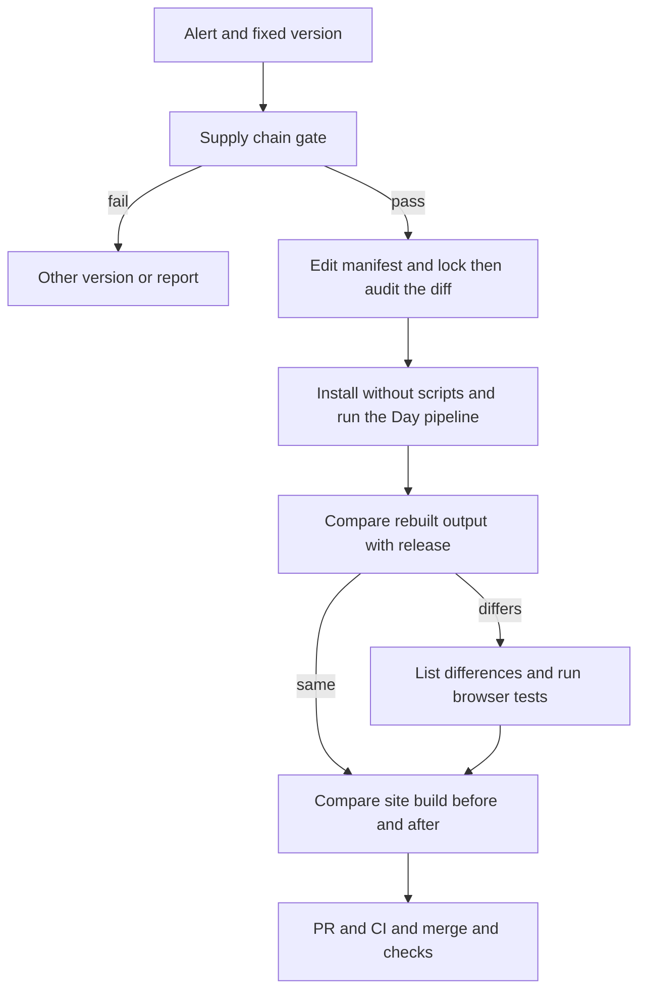

# 設計：開発用ツールの脆弱性警告の解消

## Overview
**Purpose**: Day56・58・59・61・64 の開発用ツール（vite・vitest・source-map-js）を、警告を解消する最小の版へ上げる。
**Users**: 管理者（本人）。公開サイトの訪問者に変化が出ない形で直す。
**Impact**: 変わるのは各Dayの `source/` の部品の指定とロックファイル。CI・試験が要求する Day58・61 は、公開物（配信ファイル）の作り直しも伴う。コードは書かない。

### Goals
- 警告41件を、修正に必要な最小の版で閉じる（1.x）。配信ファイルと既存の検査は変えない（2.x・3.x）。
- 取り込む部品と実行するコマンドの安全を、実行の前後に証拠つきで確かめる（4.x）。

### Non-Goals
- 最新版への追随、実行時の部品の更新、Dependabot・コードスキャンの設定、CIの変更、Day64のRust・Wasm。

## Boundary Commitments
### This Spec Owns
- 5つのDayの `source/package.json`・`package-lock.json` の更新。
- 更新で古くなる記録の再生成（Day61 の `build-record.json` と `legal/`）。
- 更新の安全確認と証拠（`tasks.md`・PR本文）、再発を防ぐ手順書（steering）。
### Out of Boundary
- アプリの機能、公開物の改良、CIワークフロー、本人が作業中のフォルダ。公開物の差し替えは2.3の条件を満たすときだけ。
### Allowed Dependencies
- 公式レジストリと公開の脆弱性データベース（読み取りのみ）、GitHub（読み取りと、PR・マージ）、各Dayの既存のnpmスクリプトとCI。
### Revalidation Triggers
- 修正版に対する新しい警告。CIの再現性検査や Day61 の記録の形式の変更。Node・npmの主版本の変更。`source/` を持つDayの追加。

## Architecture
### Existing Architecture Analysis
`source/` はビルドの入力で、サイトは `source/` から作ってコミットした公開物を配信する（`source/` と `tools/` は配信されない）。部品の更新は、ソースと公開物を結ぶ3つの仕組みを通る。

| 結び目 | 内容 | 対象 |
|---|---|---|
| 再現性検査 | CIがビルドし直し、公開物と1バイトでも違えば失敗 | Day56・58 |
| 記録の単体試験 | package.json と lock を含むソースのハッシュを `build-record.json` と照合 | Day61 |
| ライセンス表記 | `legal/` に vite・rolldown の版が載り、試験と `notices:check` が照合 | Day59・61 |

**Selected pattern**: Dayごとに独立した「最小の編集 → 差分の監査 → ロックどおりに入れ直す → そのDayの手順で作り直して比べる」。5つのDayは別の組なので並行でき、1本のPRにまとめてDayごとに外せる。道具は Node 24・npm 12（CIと同じ主版本）、公式レジストリ・OSV・GitHub API（読み取り）、jq、gitleaks、`npm run check`。

- 公開物の更新は、CIの再現性検査（Day56・58）か記録の単体試験（Day61）が要求するDayに限る。更新するDayは、そのDayのブラウザ試験が通ったときだけ更新する（2.3）。要求しないDay（59・64）は作り直さない。viteの先読みの補助コードは成果物に入るので、作り直すと本番のJSが変わるため。
- rolldown は npm が選んだ版（公開から3日以上）を使う。固定して比べる手間に見合う差が出なかった。

## File Structure Plan
- `day-0{56,58,59,61,64}-*/source/package.json`・`package-lock.json` — vite・vitest の指定（固定のDayは固定のまま、`^` のDayは下限を引き上げ）と、解決済みの版（source-map-js、Day59・61 は rolldown も）
- 公開物の作り直し（2.3）：Day58 の `index.html`・`assets/`、Day61 の `index.html`・`assets/`・`legal/`・`source/public/legal/`・`source/build-record.json`（いずれも各Dayの `release` が書く）。Day59・64 は作り直さない
- `.kiro/specs/dev-deps-security-2026-10/` — この仕様。`.kiro/steering/dependency-updates.md`（新規）— 結び目と更新の手順・落とし穴
- コミットしない：`.kiro/settings/`（仕様の作成に使ったひな形）

## Requirements Traceability
| Req | Components | 確かめ方 |
|---|---|---|
| 1.1 | Delivery | 反映後に警告APIで未解決0件 |
| 1.2, 1.3, 2.4 | ManifestUpdater | lock の解決版、package.json の下限、`dependencies` の版が不変 |
| 1.4, 1.5 | SupplyChainGate | 更新後の全lockをOSVで照会し、更新前と比べる |
| 2.1, 2.2, 2.3 | SiteIdentityCheck, PipelineVerifier | サイトのビルド結果の全ファイル比較と、公開物の差の一覧 |
| 3.1 | Delivery | 必須チェックと専用ワークフロー |
| 3.2, 3.3, 3.4 | PipelineVerifier | 更新前のmainも同じ手順で流して基準にする |
| 4.1, 4.2, 4.3, 4.4 | SupplyChainGate | 版ごとの公開日・取り下げ・install script の表、lock差分の取得先・整合値 |
| 4.5 | ManifestUpdater | スクリプトを実行せず入れる |
| 4.6, 4.7, 4.8 | SupplyChainGate | 実行前にスクリプトを読む。脆弱な版を見つける門番が先。送るのは名前と版だけ |
| 5.1, 5.2, 5.3, 5.4 | Delivery | 別の作業場所、選んだファイルだけ、公開前チェックとgitleaks |
| 6.1, 6.2, 6.3, 6.4 | Delivery | PR本文、必須チェックを待つ、拒否時は本人へ、反映後の確認 |

## Components and Interfaces
全て作業の手順のまとまりで、コードではない。

| Component | Intent | Files | Key Dependencies |
|---|---|---|---|
| SupplyChainGate | 取り込む版・lock差分・実行するコマンドの安全を確かめる | 書き込みなし。証拠は `tasks.md`・PR本文 | 公式レジストリ（P0）、OSV（P1） |
| ManifestUpdater | 部品の指定とlockを必要な最小だけ動かす | 各Dayの `source/package.json`・`package-lock.json` | npm（P0） |
| PipelineVerifier | Dayごとに、更新前後で入れる・試験・ビルド・リリースを流して比べる | `build-record.json`、条件つきの `legal/`・公開物 | 各Dayのnpmスクリプト（P0） |
| SiteIdentityCheck | サイトのビルド結果を前後で全ファイル比較する | 書き込みなし（`dist/` は比較だけ） | ルートのビルド（P0） |
| Delivery | 作業場所、コミット、PR、CI、マージ、反映後の確認 | この仕様、steering | GitHub・CI（P0） |

- **ゲート**: 公開日3日以上・取り下げなし・install script の有無を版ごとに表にする。lock の変更項目は、取得先が公式レジストリだけで、整合値がレジストリの値と一致し、公開日が3日以上前であること。
- **更新**: 部品名と版を指定してlockだけを動かし、`--before=2026-10-20` で新しく入る部品を縛り、`--ignore-scripts` で入れる。
- **基準**: 更新前のmainで先に同じ手順を流し、更新前から落ちる検査と、更新で落ちる検査を区別する（3.4）。

## Error Handling and Recovery
- ゲートを通らない版は使わない（別の版か、本人へ報告）。lock差分の取得先・整合値が合わなければ、コミットせず止める。
- CIが落ちたらログから直す。同じ失敗が2回続いたら本人へ返す。マージが拒否されたら、回避せずPRの状態と残りの手順を渡す（6.3）。
- 外部へ送るのは名前・版・公開情報だけ。コミットに秘密情報と手元の絶対パスを入れない。戻し方は、反映したコミットを `git revert` してPRで戻す。反映前のmainのSHAをPR本文に残す（6.1）。

## Testing Strategy
- **Day単位（手元）**: `npm ci` の成功、試験の件数が基準と同じ、型検査・ビルド・リリースの後に公開物の差を一覧にする（2.3・3.2・3.3）。
- **全体（手元）**: `npm run check`（公開前チェック・構文・単体試験・ビルド）と、`dist/` の前後比較（2.1・2.2・5.4）。
- **供給元（手元）**: 版の表、lock差分の監査、更新前後の全lockのOSV照会と門番テスト（1.4・1.5・4.1〜4.8）。
- **CI**: 必須チェック「Build and browser test」と、Day56・58・64の専用ワークフロー（3.1）。
- **反映後**: 警告APIの未解決0件、デプロイ成功、5つのDayのページが200でスクリプトのエラーなし（1.1・6.4）。
