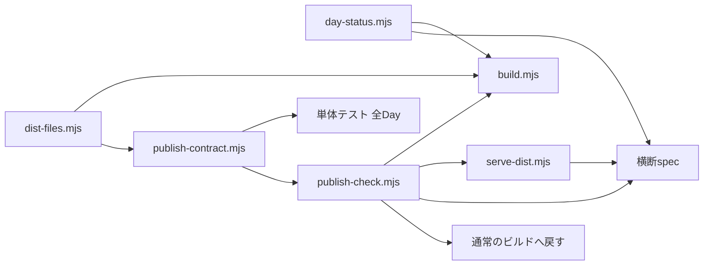

# 技術設計：公開ゲート

## Overview
横断の契約を `scripts/lib/publish-contract.mjs` に登録する。単体テストが全Dayに当て、`publish:check` も同じ登録簿を事前検査に使う。
公開前のブラウザ試験は、既存の横断specをそのまま流す。対象のDayだけを、環境変数 `PUBLISH_CHECK_DAY` で「公開済み」とみなす。

## Boundary Commitments
### This Spec Owns
契約の登録簿、下書きのDayへの静的な検査、`PUBLISH_CHECK_DAY` の解釈、`publish:check`、手順書への追記。
### Out of Boundary
CIのワークフロー、各Dayの中身、公開の操作、`x:prepare`。
### Allowed Dependencies
Node標準API、既存のPlaywright、既存の `scripts/build.mjs` と横断spec。新しい依存は足さない。
### Revalidation Triggers
横断specの項目が変われば、登録簿の契約と回帰の例を合わせ直す。`build.mjs` の公開判定が変われば、`day-status.mjs` を直す。

## Architecture

## Components

| 部品 | 責務 |
|---|---|
| `scripts/lib/day-status.mjs` | `PUBLISH_CHECK_DAY`（`71`・`071`・`day-071-…`・カンマ区切り）を読み、下書きのDayだけを公開済みとみなす。ほかの状態は変えない |
| `scripts/lib/publish-contract.mjs` | 契約の登録簿。HTMLの文字列・`meta.json`・Dayのフォルダから、違反の一覧を返す純粋な関数 |
| `scripts/tests/publish-contract.test.mjs` | 全Day（下書き含む）への検査と、違反の例（Day71の旧い共有文）の回帰 |
| `scripts/lib/dist-files.mjs` | ビルドが配信から外すフォルダの規則。ビルドのコピーと、契約の「画像が配信される」の確認が同じ関数を使う |
| `scripts/publish-check.mjs` | 静的な検査 → 環境変数つきのビルド → 検査用のサーバーを自分で立てる → 横断spec → サーバーを止める → 通常のビルドへ戻す |
| `scripts/build.mjs`、`shared-share.spec.mjs`、`external-days.spec.mjs` | 公開の判定を `day-status.mjs` 経由にする。未設定なら今までと同じ。ビルドは、除外の規則を `dist-files.mjs` から使う |
| `scripts/serve-dist.mjs` | `PLAYWRIGHT_PORT=0` のとき、OSが選んだ実際のポートを起動の1行に出す。0以外のときの出力は変えない |

## 契約の初期セット
6つは、横断specが静的に確かめている項目の写し。1つ（`build-injection`）は、ビルドの差し込み方から来る。既存の公開済みDayが、すべて通る。
ビルドは、ソースに無いcanonical・OGPのタグを `meta.json` から足す（`injectAppMeta`）。ソースに書いてあるタグは上書きしない。
だから静的な検査は、**ソースに書かれた値**を検査し、書かれていないタグは「ビルドが正しく足す」とみなす。

- canonical が `https://hundred-days.pages.dev/<フォルダ名>/` と一致する。
- `og:title` が `meta.json` の題名と一致する。`og:url` が canonical と一致する。`twitter:card` が `summary_large_image`。
- `og:image` がそのDayのフォルダを指し、指す先のファイルが実在して、**ビルドが配信する**（`tests/`・`tools/` などは配信されない）。書かれていなければ `meta.json` の `screenshot` が同じ条件を満たす（ビルドはそれを足す。無いとサイト共通の画像になり、横断specが落ちる）。
- 共有文（`share:text`。無ければ `<title>` の `|` より前）が、`meta.json` の題名をそのまま含む。
- `build-injection`：ビルドがタグを足す位置（最初の `</head>`）が、コメント・属性値・script などの中に入らない。入ると、足したタグが要素にならないか、属性が途中で切れて値が変わる。

ブラウザの計算済みスタイルが要るもの（44pxの大きさ・枠のコントラスト・共有欄が一つだけ据わること・コピー）は、登録簿に入れない。`publish:check` のブラウザ試験が受け持つ。

## 捨てた案
- **CIに「下書きも含むビルド」のジョブを足す**：CIワークフローの変更は本番の配信に直結し、手元で試せない。まず手元と単体テストで穴を埋める。足すなら別の仕様にする。
- **`meta.json` を一時的に書き換えて試験する**：中断すると作業ツリーが汚れる。環境変数で判定だけを変える。
- **横断specを、下書きも含めて常に流す**：`dist/` は配信物なので、下書きを含めると本番に出る。公開前のコマンドに分ける。
- **ブラウザ試験の項目も、すべて静的な検査に写す**：44pxやコントラストは計算済みスタイルが要る。写すと、別の実装で食い違う。

## 落とし穴
- Playwrightの `reuseExistingServer` は、同じポートに別の `dist/` を配るサーバーが残っていると、それを使ってしまう。`publish:check` は、サーバーを自分で立て（ポートはOSに選ばせ、起動の1行から完全な行だけを読む）、終わりに止める。空きポートを調べてから立てると、その間に別のプロセスがそのポートを取れる。
- 環境変数つきのビルドが `dist/` に残ると、あとの通常のE2Eが下書きを含んで走る。通常の終了・失敗・例外・SIGINT・SIGTERM・SIGHUP・出力先の切断では、サーバーを止めて通常のビルドへ戻す。SIGKILL や電源断のようにその場で止まると後始末は走らず、検査用のビルドが残ることがある（そのときは `npm run build`）。
- 下書きのDayは `publicUrl` が `null` のことがある。環境変数つきのビルドでも、canonical の組み立てが壊れないようにする。
